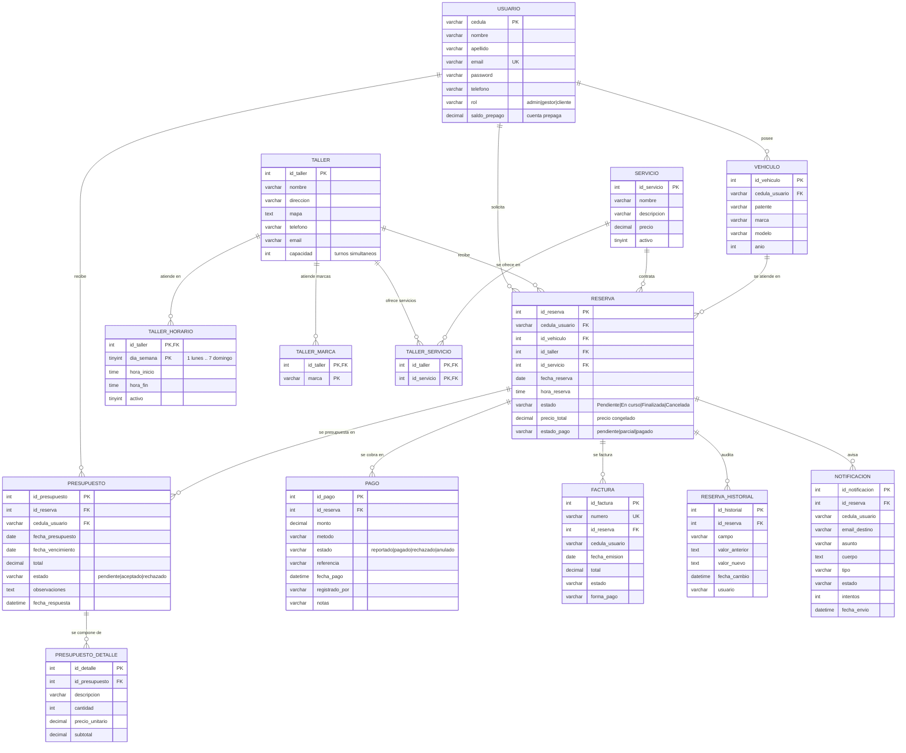
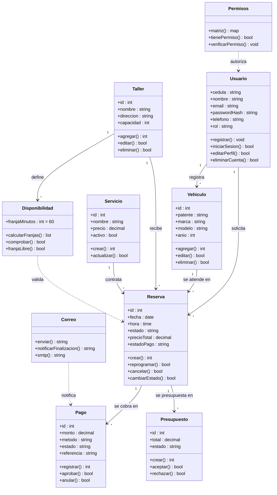
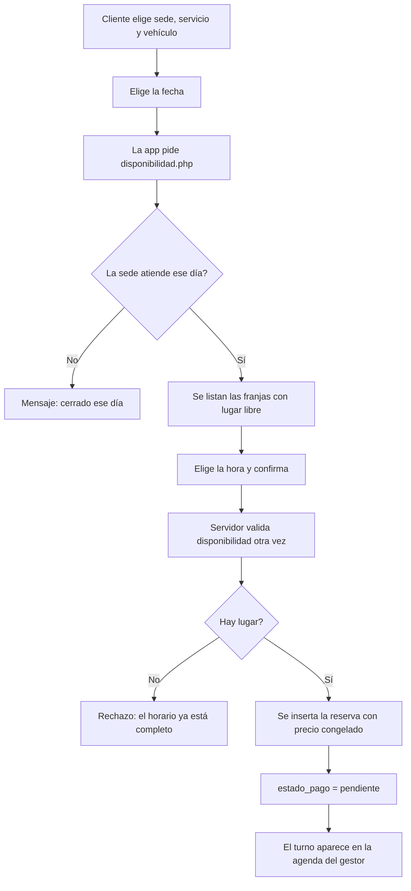
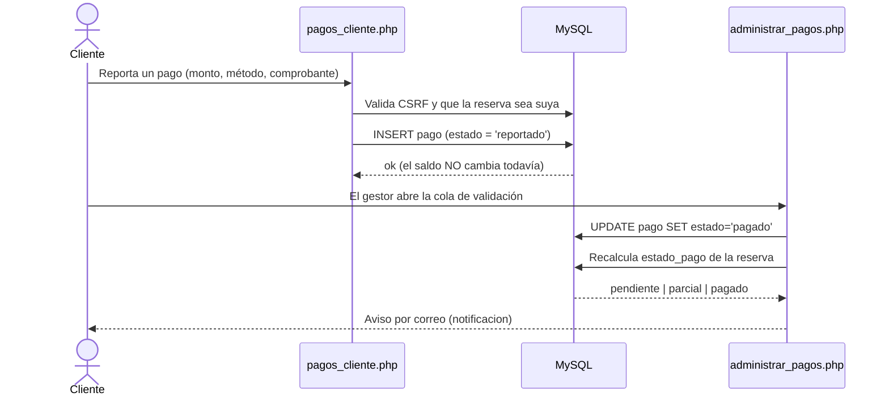
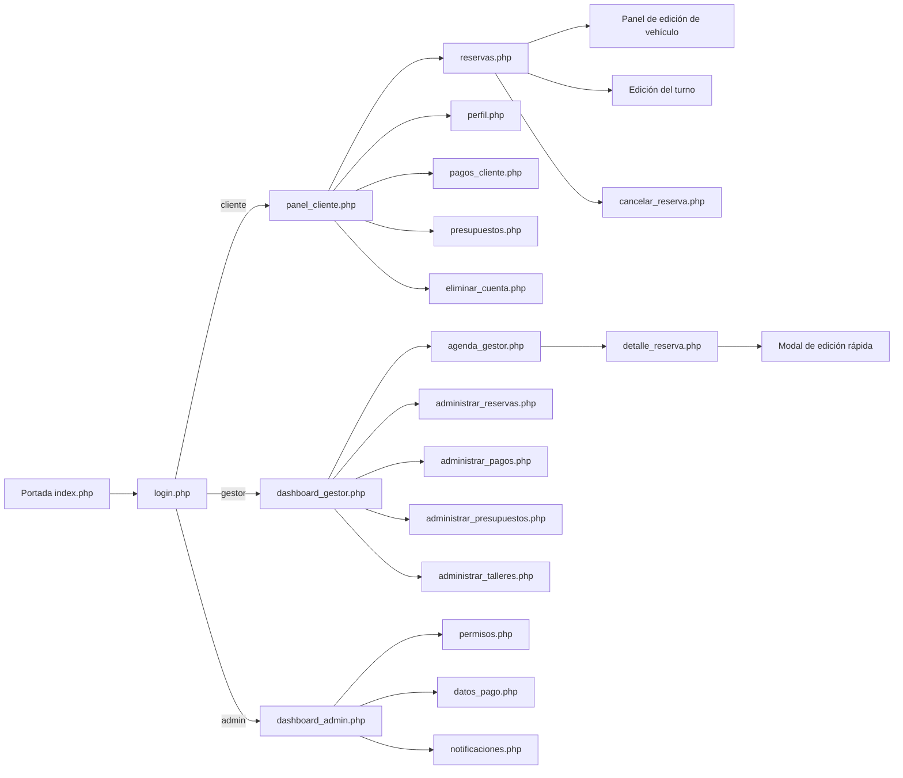
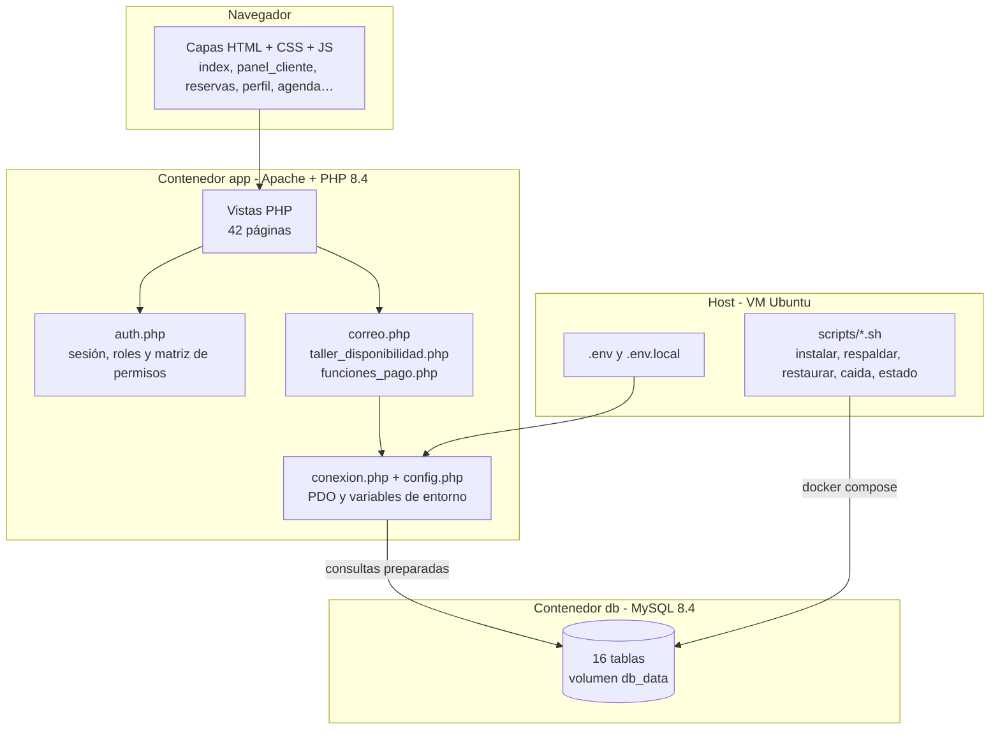

# Entregables técnicos — TGS

Documento de apoyo para la **Segunda Entrega** (Programación Full Stack, Ingeniería de Software, Administración y Sistemas Operativos, Inglés).
Todo lo que sigue está extraído del código y de la base real del proyecto, no deffa.

Diagramas en notación **Mermaid** (se renderizan en GitHub, VS Code con la extensión Mermaid, o en mermaid.live). Para entregarlos en PDF: exportá desde mermaid.live o usá la extensión "Markdown Preview Mermaid Support" y guardá como PDF.

---

## 1. Modelo Entidad-Relación (MER)



**Cardinalidades**
- Un usuario tiene 0..N vehículos y 0..N reservas; cada reserva pertenece a **exactamente 1** usuario, 1 vehículo, 1 sede y 1 servicio.
- Una reserva tiene 0..N cobros (puede ser 0 si todavía no pagó, o 2 si pagó un anticipo y el saldo).
- Un presupuesto tiene 1..N ítems y pertenece a 1 reserva.
- Una sede tiene 0..N horarios (uno por día de la semana) y 0..N reservas.

---

## 2. Normalización (1FN, 2FN, 3FN)

**1FN — Forma normal primera: valores atómicos.**
- No hay grupos repetidos: los ítems de un presupuesto están en `presupuesto_detalle` (no en una columna `items`), los horarios de una sede en `taller_horario` (no en `lunes, martes, ...`).
- Cada campo es un solo valor: `reserva.fecha_reserva` y `reserva.hora_reserva` están separados; `vehiculo.marca` y `vehiculo.modelo` también.

**2FN — Segunda forma: dependencia de toda la clave.**
- Las tablas con clave compuesta son `taller_horario` (id_taller, dia_semana) y `permiso_rol` (rol, permiso).
- En `taller_horario`, `hora_inicio` y `hora_fin` dependen de **la clave completa**: del día y la sede. No hay atributos que dependan solo de `id_taller` (eso viven en `taller`).
- En `permiso_rol`, `activo` depende de la pareja (rol, permiso), no de un solo lado.
- Las tablas de clave simple (como `pago`) ya están en 2FN por definición.

**3FN — Tercera forma: sin dependencias transitivas.**
- `reserva.precio_total` es un dato **congelado** a propósito: si dependiera de `servicio.precio` (que puede cambiar) el historial de lo cobrado se rompería. Congelarlo rompe la dependencia transitiva `reserva → servicio → precio` y da trazabilidad histórica.
- `pago` no guarda ni el nombre del cliente ni el del taller: se llega por `pago → reserva → usuario/taller`. No hay datos duplicados.
- `presupuesto.total` es una *suma derivada* de sus ítems: se mantiene para consultar rápido, pero la fuente real es `presupuesto_detalle.subtotal` (decisión consciente, documentada).

**FNBC y 4FN (bonus):** todas las dependencias son de clave completa → cumple BCNF. No hay dependencias multivaluadas fuera de las tablas de detalle → 4FN.

---

## 3. Diccionario de datos

16 tablas. `PK` = clave primaria, `FK` = clave foránea, `UK` = único.

### 3.1 `usuario`
| Columna | Tipo | Nulo | Clave | Default | Descripción |
|---|---|---|---|---|---|
| cedula | varchar(20) | no | **PK** | | Cédula de identidad; identifica al usuario en toda la base |
| nombre | varchar(100) | no | | | Nombre |
| apellido | varchar(100) | sí | | | Apellido |
| email | varchar(150) | no | **UK** | | Correo de acceso; es el identificador de login |
| password | varchar(255) | no | | | Hash bcrypt (nunca el texto plano) |
| telefono | varchar(30) | sí | | | Teléfono de contacto |
| rol | varchar(50) | no | | 'cliente' | `admin`, `gestor` o `cliente` |

Índices: `PRIMARY (cedula)`, `UNIQUE (email)`, `usuario_rol_idx (rol)`.

### 3.2 `vehiculo`
| Columna | Tipo | Nulo | Clave | Default | Descripción |
|---|---|---|---|---|---|
| id_vehiculo | int | no | **PK** | AI | Identificador del vehículo |
| cedula_usuario | varchar(20) | no | **FK** | | → `usuario.cedula` (CASCADE) |
| patente | varchar(20) | no | | | Dominio de matrícula |
| marca | varchar(50) | no | | | Toyota, Volkswagen… |
| modelo | varchar(50) | no | | | Corolla, Gol… |
| anio | int | sí | | | Año del modelo |

Índices: `PRIMARY (id_vehiculo)`, `vehiculo_usuario_idx (cedula_usuario)`.

### 3.3 `taller`
| Columna | Tipo | Nulo | Clave | Default | Descripción |
|---|---|---|---|---|---|
| id_taller | int | no | **PK** | AI | Identificador de la sede |
| nombre | varchar(100) | no | | | Nombre comercial |
| direccion | varchar(200) | no | | | Dirección |
| mapa | text | sí | | | Código HTML (iframe) del mapa de Google |
| telefono | varchar(30) | sí | | | Teléfono |
| email | varchar(100) | sí | | | Correo |
| capacidad | int | no | | 2 | Turnos simultáneos que acepta |

### 3.4 `taller_horario`
| Columna | Tipo | Nulo | Clave | Default | Descripción |
|---|---|---|---|---|---|
| id_taller | int | no | **PK**,**FK** | | → `taller.id_taller` (CASCADE) |
| dia_semana | tinyint | no | **PK** | | 1 = lunes … 7 = domingo |
| hora_inicio | time | no | | | Apertura de la sede ese día |
| hora_fin | time | no | | | Cierre de la sede ese día |
| activo | tinyint(1) | no | | 1 | 0 = día cerrado |

### 3.5 `servicio`
| Columna | Tipo | Nulo | Clave | Default | Descripción |
|---|---|---|---|---|---|
| id_servicio | int | no | **PK** | AI | Identificador del servicio |
| nombre | varchar(120) | no | | | Nombre del servicio |
| descripcion | varchar(255) | sí | | | Detalle |
| precio | decimal(10,2) | no | | 0.00 | Precio de lista |
| activo | tinyint(1) | no | | 1 | Solo los activos se pueden reservar |

### 3.6 `reserva`
| Columna | Tipo | Nulo | Clave | Default | Descripción |
|---|---|---|---|---|---|
| id_reserva | int | no | **PK** | AI | Identificador del turno |
| cedula_usuario | varchar(20) | no | **FK** | | → `usuario.cedula` (CASCADE) |
| id_vehiculo | int | no | **FK** | | → `vehiculo.id_vehiculo` (CASCADE) |
| id_taller | int | no | **FK** | | → `taller.id_taller` (CASCADE) |
| id_servicio | int | no | **FK** | | → `servicio.id_servicio` (CASCADE) |
| fecha_reserva | date | no | | | Día del turno |
| hora_reserva | time | no | | | Hora del turno |
| estado | varchar(50) | no | | 'Pendiente' | Pendiente / En curso / Finalizada / Cancelada |
| precio_total | decimal(10,2) | sí | | | Precio **congelado** al reservar (base del cobro) |
| estado_pago | varchar(20) | no | | 'pendiente' | pendiente / parcial / pagado (se recalcula en cada cobro) |

### 3.7 `pago`
| Columna | Tipo | Nulo | Clave | Default | Descripción |
|---|---|---|---|---|---|
| id_pago | int | no | **PK** | AI | Identificador del cobro |
| id_reserva | int | no | **FK** | | → `reserva.id_reserva` (CASCADE) |
| monto | decimal(10,2) | no | | 0.00 | Importe del cobro |
| metodo | varchar(30) | no | | 'efectivo' | efectivo / tarjeta / transferencia |
| estado | varchar(20) | no | | 'pagado' | reportado / pagado / rechazado / anulado |
| referencia | varchar(60) | sí | | | N.º de comprobante o transferencia |
| fecha_pago | datetime | no | | NOW | Momento del cobro |
| registrado_por | varchar(20) | sí | | | Cédula de quien lo registró o validó |
| notas | varchar(255) | sí | | | Observación |

### 3.8 `presupuesto` y `presupuesto_detalle`
| Tabla | Columna | Tipo | Clave | Descripción |
|---|---|---|---|---|
| presupuesto | id_presupuesto | int | **PK** | Identificador |
| | id_reserva | int | **FK** | → `reserva.id_reserva` (CASCADE) |
| | cedula_usuario | varchar(20) | **FK** | → `usuario.cedula` (CASCADE) |
| | fecha_presupuesto | date | | Fecha de emisión |
| | fecha_vencimiento | date | | Vencimiento de la propuesta |
| | total | decimal(10,2) | | Suma de los ítems (caché de consulta) |
| | estado | varchar(20) | | pendiente / aceptado / rechazado |
| | observaciones | varchar(255) | | Notas para el cliente |
| | fecha_respuesta | datetime | | Cuándo respondió el cliente |
| | respondido_por | varchar(20) | | Cédula de quien respondió |
| | creado_por | varchar(20) | | Cédula de quien lo generó |
| presupuesto_detalle | id_detalle | int | **PK** | Identificador del ítem |
| | id_presupuesto | int | **FK** | → `presupuesto.id_presupuesto` (CASCADE) |
| | descripcion | varchar(255) | | Concepto (repuesto, mano de obra) |
| | cantidad | int | | Cantidad |
| | precio_unitario | decimal(10,2) | | Precio por unidad |
| | subtotal | decimal(10,2) | | cantidad × precio_unitario |

### 3.9 `reserva_historial`
| Columna | Tipo | Clave | Descripción |
|---|---|---|---|
| id_historial | int | **PK** | Identificador |
| id_reserva | int | **FK** | → `reserva.id_reserva` |
| campo | varchar(50) | | Campo modificado (fecha, hora, estado…) |
| valor_anterior | text | | Valor previo |
| valor_nuevo | text | | Valor nuevo |
| fecha_cambio | datetime | | Momento del cambio |
| usuario | varchar(100) | | Quién lo hizo |

### 3.10 `notificacion`
| Columna | Tipo | Clave | Descripción |
|---|---|---|---|
| id_notificacion | int | **PK** | Identificador |
| id_reserva | int | **FK** | → `reserva.id_reserva` (CASCADE) |
| cedula_usuario | varchar(20) | | Destinatario interno |
| email_destino | varchar(150) | | Correo al que se envió |
| asunto | varchar(200) | | Asunto |
| cuerpo | text | | Mensaje |
| tipo | varchar(40) | | finalizacion / reprogramacion / general |
| estado | varchar(20) | | pendiente / enviado / error |
| respuesta_transporte | varchar(250) | | Lo que respondió el servidor de correo |
| intentos | int | | Cuántos intentos se hicieron |
| fecha_envio | datetime | | Cuándo se envió |

### 3.11 `permiso_rol`
| Columna | Tipo | Clave | Descripción |
|---|---|---|---|
| rol | varchar(50) | **PK** | admin / gestor / cliente |
| permiso | varchar(80) | **PK** | Nombre del permiso (29 definidos) |
| activo | tinyint(1) | | 0 = ese rol no tiene el permiso |
| updated_at | timestamp | | Última modificación |

### 3.12 `datos_pago`
| Columna | Tipo | Clave | Descripción |
|---|---|---|---|
| id_datos_pago | int | **PK** | Identificador |
| nombre | varchar(100) | | Nombre de la cuenta |
| alias | varchar(60) | | Alias bancario |
| cbu | varchar(34) | | CBU |
| qr | varchar(500) | | URL o `` del código QR |
| notas | varchar(255) | | Indicaciones para el cliente |
| activo | tinyint(1) | | Si está visible para el cliente |

### 3.13 `factura`
| Columna | Tipo | Clave | Descripción |
|---|---|---|---|
| id_factura | int | **PK** | Identificador |
| numero | varchar(30) | **UK** | Número correlativo `F-AAAA-NNNN` |
| id_reserva | int | **FK** | → `reserva.id_reserva` (CASCADE) |
| cedula_usuario | varchar(20) | | Cliente facturado |
| fecha_emision | date | | Fecha de emisión |
| total | decimal(10,2) | | Importe facturado |
| estado | varchar(20) | | emitida / anulada |
| forma_pago | varchar(30) | | Método con que se pagó |

### 3.14 `taller_marca` y `taller_servicio`
| Tabla | Columna | Tipo | Clave | Descripción |
|---|---|---|---|---|
| taller_marca | id_taller | int | **PK**,**FK** | → `taller.id_taller` (CASCADE) |
| | marca | varchar(50) | **PK** | Marca de vehículo atendida por la sede |
| taller_servicio | id_taller | int | **PK**,**FK** | → `taller.id_taller` (CASCADE) |
| | id_servicio | int | **PK**,**FK** | → `servicio.id_servicio` (CASCADE) |

Estas dos tablas son puentes: una sede atiende varias marcas y ofrece varios servicios (relación N:M), que es lo que permite filtrar las sedes por marca y por tipo de servicio (requisito 4.2 del enunciado).

### 3.15 `usuario.saldo_prepago`
| Columna | Tipo | Clave | Descripción |
|---|---|---|---|
| saldo_prepago | decimal(10,2) | | Saldo de la cuenta prepaga del cliente (0.00) |

Es la columna que permite al cliente pagar su servicio directamente desde la aplicación (requisito 7.1): al usar el saldo, el cobro queda pagado al instante y el saldo se descuenta en la misma transacción.

---

## 4. Diagramas de Ingeniería de Software

### 4.1 Diagrama de clases (módulos de dominio)

> El proyecto es **procedural con funciones de dominio** (sin framework ni clases). Cada bloque del diagrama representa un módulo del código con sus datos y operaciones, que es la equivalencia funcional que pide el enunciado.



### 4.2 Diagrama de actividades (reservar un turno)



### 4.3 Diagrama de secuencia (validar un pago reportado)



### 4.4 Diagrama de navegabilidad



### 4.5 Diagrama de componentes (arquitectura)



### 4.6 Diagrama de despliegue

```mermaid
flowchart TB
    ClienteN[Cliente / navegador] -->|HTTP :8080| VM
    GestorN[Gestor / navegador] -->|HTTP :8080| VM
    AdminN[Administrador / navegador] -->|HTTP :8080| VM

    subgraph VM["VirtualBox - Ubuntu 26.04 - IP de la red local"]
        Apache[Contenedor tgs_app<br/>Apache + PHP 8.4<br/>puerto 80 → 8080]
        MySQL[Contenedor tgs_db<br/>MySQL 8.4 + healthcheck]
        Vol[(Volumen db_data)]
        Repo[/home/taller/Desktop/tgs<br/>proyecto montado en caliente]
        Scripts[scripts/*.sh<br/>instalar / respaldar / restaurar / caida / estado]
        Repo --> Apache
        Apache --> MySQL
        MySQL --> Vol
        Scripts --> Apache
        Scripts --> MySQL
    end
```

---

## 5. Glosario bilingüe de la interfaz (UI)

| Español | English | Dónde aparece |
|---|---|---|
| Taller Global de Servicios | Global Workshop Services | Marca del proyecto |
| Iniciar Sesión / Ingresar | Sign In / Log In | `login.php` |
| Registrarse | Create Account | `registro.php` |
| Panel del Cliente | Customer Panel | `panel_cliente.php` |
| Panel del Gestor | Manager Panel | `dashboard_gestor.php` |
| Panel de Administración | Admin Panel | `dashboard_admin.php` |
| Mis turnos | My appointments | `reservas.php` |
| Mis vehículos | My vehicles | `panel_cliente.php` |
| Mis presupuestos | My budgets | `presupuestos.php` |
| Mis pagos | My payments | `pagos_cliente.php` |
| Mi perfil | My profile | `perfil.php` |
| Dar de baja mi cuenta | Delete my account | `eliminar_cuenta.php` |
| Reservar Turno | Book Appointment | `reservas.php` |
| Nuevo vehículo | New vehicle | `reservas.php` |
| Editar vehículo | Edit vehicle | `reservas.php` |
| Eliminar vehículo | Delete vehicle | `reservas.php` |
| Editar turno | Edit appointment | `reservas.php` |
| Cancelar turno | Cancel appointment | `reservas.php` |
| Sede | Workshop | `reservas.php`, `administrar_talleres.php` |
| Horario de atención | Opening hours | `administrar_talleres.php` |
| Capacidad simultánea | Simultaneous capacity | `administrar_talleres.php` |
| Talleres de servicio | Service workshops | `administrar_talleres.php` |
| Ubicación en el mapa | Location on the map | `administrar_talleres.php` |
| Agenda del día | Daily agenda | `agenda_gestor.php` |
| Franja / horario libre | Free time slot | `agenda_gestor.php` |
| Turno pendiente | Pending appointment | `agenda_gestor.php` |
| Estado de cobro | Collection status | `administrar_pagos.php` |
| Registrar cobro | Register payment | `administrar_pagos.php` |
| Aprobar / Rechazar | Approve / Reject | `administrar_pagos.php` |
| Cobros reportados por los clientes | Payments reported by customers | `administrar_pagos.php` |
| Importe a pagar | Amount to pay | `pagos_cliente.php` |
| Datos para transferir | Bank details | `pagos_cliente.php` |
| Alias / CBU | Alias / CBU | `pagos_cliente.php` |
| Reportar pago | Report payment | `pagos_cliente.php` |
| Comprobante o referencia | Receipt or reference | `pagos_cliente.php` |
| Presupuesto | Budget | `administrar_presupuestos.php` |
| Items | Items | `administrar_presupuestos.php` |
| Aceptar / Rechazar presupuesto | Accept / Reject budget | `presupuestos.php` |
| Matriz de permisos | Permission matrix | `permisos.php` |
| Ver / Editar permisos | View / Edit permissions | `permisos.php` |
| Avisos al cliente | Customer notices | `notificaciones.php` |
| Reenviar aviso | Send notice again | `notificaciones.php` |
| Datos bancarios para pagos | Bank details for payments | `datos_pago.php` |
| Caso de uso | Use case | Ingeniería de Software |
| Cliente | Customer | Dominio |
| Gestor de puntos de carga | Service point manager | Dominio |
| Administrador | Administrator | Dominio |
| Turno | Appointment | Dominio |
| Vehículo | Vehicle | Dominio |
| Servicio | Service | Dominio |
| Sede | Workshop | Dominio |
| Cobro / Pago | Payment | Dominio |
| Factura | Invoice | Dominio |

---

## 6. Glosario técnico (para el apartado de Inglés / Implementation)

| Español | English | Definición |
|---|---|---|
| Taller | Workshop | Sede física donde se realiza el mantenimiento |
| Turno | Appointment | Reserva de un servicio para una fecha y hora |
| Franja horaria | Time slot | Bloque de 60 minutos dentro del horario de la sede |
| Capacidad | Capacity | Cantidad de turnos simultáneos de una sede |
| Cobro | Payment | Registro de un importe cobrado por un turno |
| Reportado | Reported | Cobro declarado por el cliente, aún sin validar |
| Aprobar | Approve | Validación del cobro por parte del taller |
| Presupuesto | Budget | Propuesta de trabajo detallada con ítems y precio |
| Anular | Void | Invalidar un cobro sin borrarlo |
| Eje de sesión | Session ID | Identificador de la sesión del usuario |
| Consulta preparada | Prepared statement | Consulta SQL con parámetros separados de la consulta |
| Hash bcrypt | bcrypt hash | Contraseña almacenada como hash irreversible |
| Token CSRF | CSRF token | Token anti falsificación de peticiones |
| Matriz de permisos | Permission matrix | Mapa rol → permisos |
| Archivo de variables de entorno | Environment file | Archivo `.env` con la configuración |
| Volumen | Volume | Espacio de datos persistente de Docker |
| Capa | Container | Unidad de ejecución aislada de Docker |
